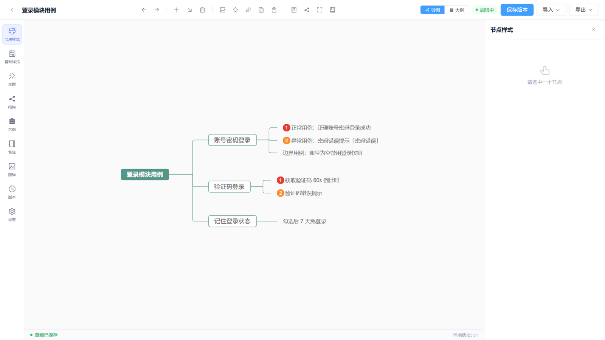
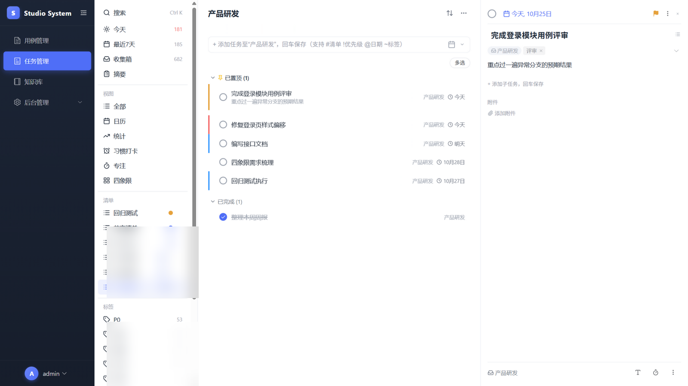
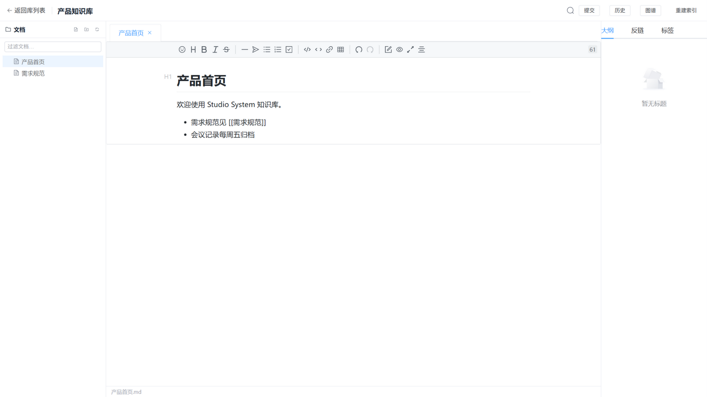
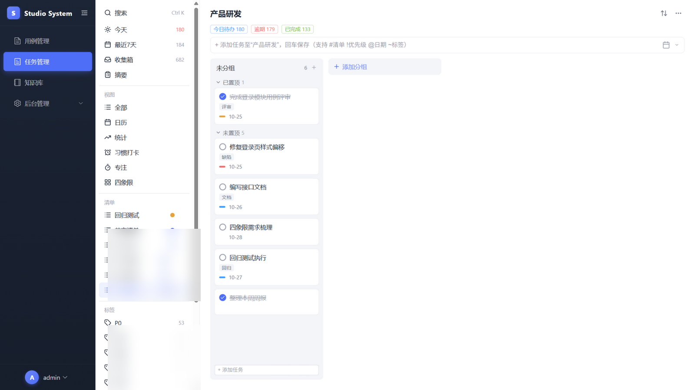

<div align="center">

# Studio System

**一站式创作与工作台** · 用例导图 · 任务管理 · 知识库 · 专注与习惯

*Test-case mind maps, To-do-app-style task management, Git-powered wiki, pomodoro & habits — a self-hosted collaboration workspace for small teams.*

`Vue 3` · `Element Plus` · `FastAPI` · `MongoDB` · `simple-mind-map` · `MIT License`

</div>

---

## 简介

Studio System 把小团队的日常工作流整合进一个可私有化的系统：

- **用例管理**：思维导图组织测试用例与需求拆解，在线编辑、版本快照与回滚、XMind / Markdown 互导、层级文本大纲视图
- **任务管理**：对齐主流待办应用的任务系统——智能清单、列表 / 看板 / 日历 / 时间线 / 四象限 / 统计多视图、快速添加语法、子任务与附件
- **知识库 Wiki**：基于 Git 的在线 Obsidian——Markdown 所见即所得、`[[双链]]`、关系图谱、行级 diff 与回滚
- **专注与习惯**：番茄钟 / 正计时 / 沉浸模式、专注统计、每日习惯打卡
- **平台管理**：用户 / 角色 / 权限（RBAC + ACL），清单级共享协作

前后端分离，数据全部落在你自己的 MongoDB 与 Git 仓库里。

| | |
|---|---|
|  |  |
| *用例导图编辑器* | *任务清单与详情抽屉* |
|  |  | 
| *Wiki 工作区* | *任务看板* |

## 快速开始

> 📖 **在线阅读文档：<https://088729.github.io/studiosystem/>**（或本地打开 `docs/index.html`）

```bash
# 后端（Python ≥ 3.11 + MongoDB ≥ 6.0）
cd backend
uv venv && uv pip install -e ".[dev]"
copy .env.example .env        # 按需修改数据库地址与密钥
start.bat                     # 或 uvicorn app.main:app --reload --port 8302

# 前端（Node ≥ 18）：先装一次导图内核的依赖，再装前端依赖
cd frontend
npm ci --prefix ../packages/simple-mind-map --omit=dev
npm ci
npm run dev                   # http://localhost:5173
```

默认管理员：`admin / admin123`（生产环境务必通过 `ADMIN_INITIAL_PASSWORD` 修改）。

## 仓库结构

```
studiosystem/
├── backend/                     # FastAPI 后端
│   ├── app/                     # 路由 / 模型 / 服务 / 配置
│   ├── deploy/                  # Kubernetes 清单
│   └── Design/                  # 模块设计文档
├── frontend/                    # Vue 3 前端
│   └── src/views/               # case / task / wiki / platform 各模块
├── packages/simple-mind-map/    # simple-mind-map 定制版（收编的本地依赖）
└── docs/                        # 使用文档（HTML，含截图）
```

## 文档

| 文档 | 内容 |
|------|------|
| **[在线使用文档](https://088729.github.io/studiosystem/)**（源文件 [docs/](docs/)） | 部署 + 全模块使用文档（图文） |
| [backend/README.md](backend/README.md) | 后端接口与模块说明 |
| [frontend/README.md](frontend/README.md) | 前端功能与页面说明 |
| [backend/Design/](backend/Design/) | 存储层 / Wiki / 导图设计文档 |

## License

[MIT](LICENSE) · `packages/simple-mind-map` 基于 [wanglin2/mind-map](https://github.com/wanglin2/mind-map)（MIT）定制，一并以 MIT 提供。
